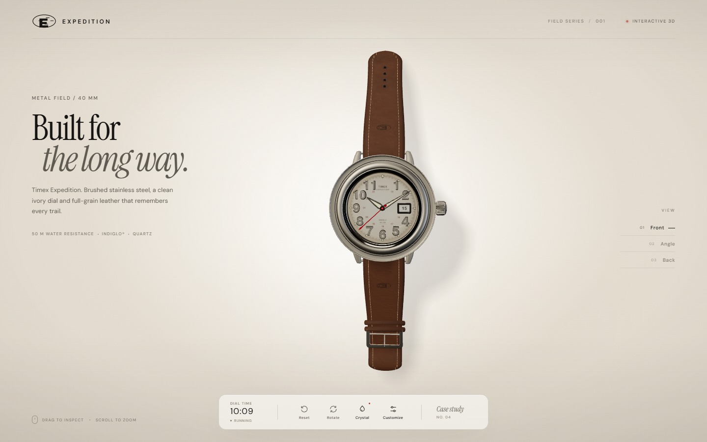
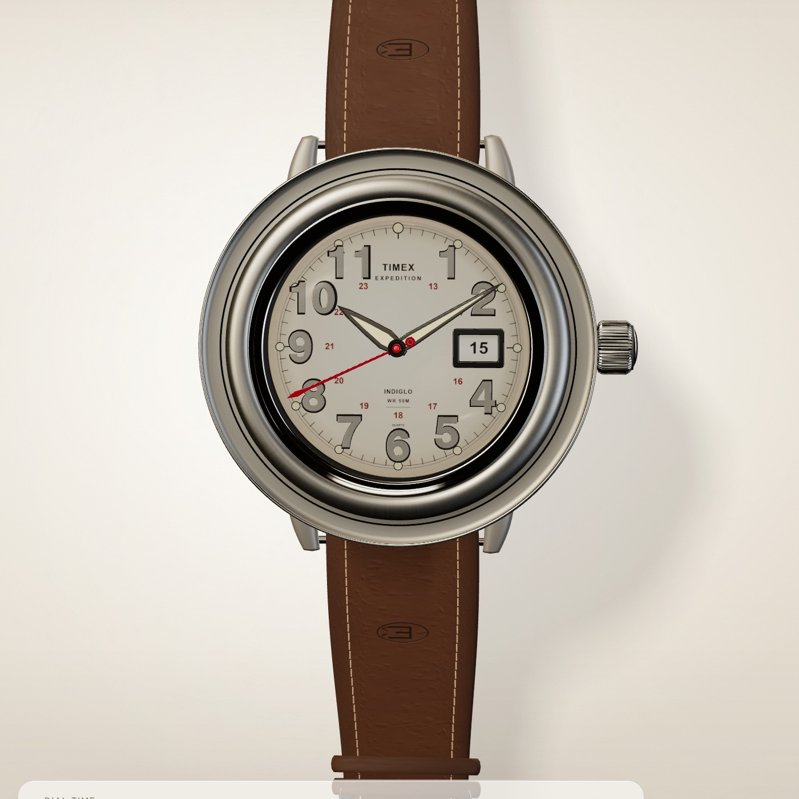
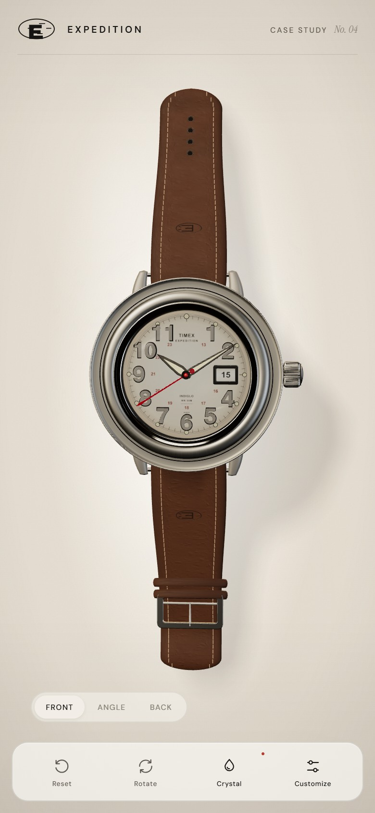

# Timex Expedition — Metal Field

A photorealistic, interactive 3D study of the Timex Expedition Metal Field, built with Three.js. The watch, leather, stitching, crystal and dial print are generated and rendered in real time in the browser — no 3D model files or photographic assets.



<p align="center">
  
  
</p>

## About this study

The Expedition Metal Field is a study in restraint: a broad brushed-steel case, a warm ivory dial with full Arabic numerals, a date window and a second time scale, and a tapered full-grain leather strap. This project translates that field-watch character into a small editorial product experience.

The scene uses procedural geometry and canvas-drawn textures throughout. Metal is lit by a studio environment, the dial carries a subtly domed crystal, and the leather is built from a neutral hide and tinted into four finishes so its grain and saddle stitching survive the colour change.

## Features

- **Procedural watch model** — case, bezel, lugs, crown, dial furniture, hands, date disc, strap, keepers and buckle.
- **Canvas-generated textures** — ivory dial print, 24-hour scale, date disc, caseback engraving and leather grain.
- **Real-time materials** — PBR brushed and polished steel, domed mineral crystal, lume, waxed thread and tinted full-grain leather.
- **Live or manual time** — run on the local clock or set the hour and minute by hand; sweeping seconds can be toggled.
- **Customizer** — Walnut, Saddle, Espresso and Black leather, plus Studio, Daylight and Noir lighting presets.
- **Camera controls** — front, three-quarter and caseback views, orbit, zoom, reset and automatic rotation.
- **Crystal toggle** — compare the watch with and without glass reflections.
- **Responsive layout** — an editorial desktop composition with a bottom-sheet customizer on small screens.

## Controls

| Action | Control |
| --- | --- |
| Orbit | Drag anywhere on the watch |
| Zoom | Scroll over the canvas |
| Camera views | Front / Angle / Back |
| Reset camera | Reset button |
| Auto-rotate | Rotate button |
| Glass reflections | Crystal button |
| Leather, lighting and time | Customize panel |

## Run locally

```bash
npm install
npm run dev
```

Vite serves the app at `http://localhost:5173/`.

For a production build:

```bash
npm run build
npm run preview
```

## Tech stack

- [Three.js](https://threejs.org/) — WebGL rendering, PBR materials, procedural geometry
- [Vite](https://vite.dev/) — development server and production bundling
- Vanilla JavaScript, HTML and CSS
- Canvas 2D — all dial, date, leather and engraving textures
- Fonts: Instrument Serif, DM Sans and Helvetiker

## Project structure

```text
.
├── public/
│   └── fonts/               # UI and dial typefaces
├── src/
│   ├── main.js              # Scene, camera, interactions, UI state
│   ├── environment.js       # Studio lighting and reflections
│   ├── textures.js          # Canvas-drawn dial, date and material maps
│   ├── style.css            # Editorial layout and responsive controls
│   └── watch/
│       ├── index.js         # Watch assembly
│       ├── case.js          # Case, bezel, lugs and crown
│       ├── dial.js          # Dial, numerals, lume and date
│       ├── hands.js         # Hands and sweeping seconds
│       ├── strap.js         # Curved leather straps, stitching and buckle
│       ├── materials.js     # Shared PBR materials
│       └── utils.js
├── index.html
└── package.json
```

## Notes

Every surface and texture is authored in code, so the visual result is resolution-independent and can be re-lit or re-coloured without re-exporting assets.

## Disclaimer

This is an independent, non-commercial design study made for learning and portfolio purposes. It is not affiliated with, endorsed by or sponsored by Timex Group. “Timex” and “Expedition” are trademarks of their respective owner. The watch design is inspired by the Timex Expedition Metal Field reference TW4B.
